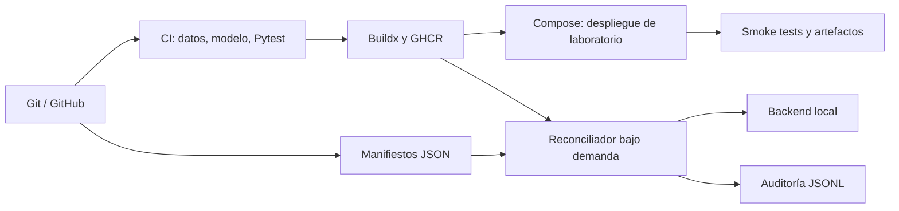

# Sentinel MLOps & GitOps

**Detección de fraude en seguros de automóviles | Ciclo de vida de IA, CI/CD, observabilidad y gobernanza**

[](https://github.com/Katya925/sentinel-mlops-gitops/actions/workflows/ci.yml)

> Prototipo académico. Apoyo a la revisión humana; no autorizado para producción real ni para rechazar reclamaciones automáticamente.

## 1. Resumen ejecutivo y valor de negocio

Sentinel prioriza reclamaciones potencialmente fraudulentas mediante Random Forest y una API FastAPI. Busca orientar la capacidad de investigación hacia casos sospechosos, sin sustituir el juicio del analista. La automatización reduce tareas repetitivas de integración y despliegue; la observabilidad facilita el diagnóstico y la recuperación. No se han medido ahorros monetarios ni impacto comercial real.

| Resultado de laboratorio | Valor |
|---|---:|
| Pruebas API | 12/12 |
| Smoke tests | 3/3 |
| Variables de entrada | 32 |
| Construcción Docker, reducción promedio observada | 64.66% |
| Duración acumulada de trabajos, reducción promedio observada | 38.26% |
| Promoción, rollback manual y reconciliación bajo demanda | Validados |

## 2. Evolución del proyecto

| Etapa | Alcance |
|---|---|
| [Sentinel Fraud Detection](https://github.com/Katya925/sentinel-fraud-detection) | Modelo predictivo, FastAPI y Streamlit |
| [Sentinel Observability](https://github.com/Katya925/sentinel-observability) | Métricas, trazas, drift, alertas e incidentes |
| [Sentinel MLOps & GitOps](https://github.com/Katya925/sentinel-mlops-gitops) | CI/CD, versionado, reconciliación, auditoría y optimización |

## 3. Modelo y límites predictivos

El modelo Random Forest se conserva sin reentrenamiento en esta etapa. Los metadatos históricos suministrados (`backend/sentinel_metadata.json`) identifican `RF_Optimizado`, objetivo `FraudFound_P`, umbral 0.19 y revisión humana obligatoria.

| Métrica | Validación histórica | Prueba exploratoria histórica |
|---|---:|---:|
| Precision | 29.59% | 28.34% |
| Recall | 31.35% | 28.80% |
| F1 | 30.45% | 28.57% |
| FPR | 4.76% | 4.62% |
| Accuracy | — | 91.41% |
| ROC-AUC | — | 0.8438 |
| PR-AUC | — | 0.2805 |

En la prueba exploratoria se registraron 53 verdaderos positivos, 134 falsos positivos, 131 falsos negativos y 2766 verdaderos negativos. El recall limitado y los falsos positivos justifican la supervisión humana. La accuracy aislada no demuestra utilidad suficiente en un problema desbalanceado. Estas métricas no se recalcularon en la fase MLOps; los smoke tests no miden calidad predictiva.

## 4. Arquitectura



La arquitectura operativa heredada es independiente del runner efímero de CI:

```text
                  USUARIO
                     |
                     v
                STREAMLIT
                     |
                     v
                  FASTAPI
                     |
                     v
               RANDOM FOREST
                     |
              PREDICCIÓN ML
                     |
       +-------------+-------------+
       |             |             |
       v             v             v
    MÉTRICAS        LOGS         TRAZAS
       |             |             |
       v             |             v
   PROMETHEUS        |       OPENTELEMETRY
       |             |             |
       v             |             v
    GRAFANA          |           TEMPO
                     |             |
                     v             v
                 DOCKER LOGS     GRAFANA

       MONITORIZACIÓN DEL MODELO
                     |
                     v
                 EVIDENTLY
                     |
                     v
                  MLFLOW
```

La arquitectura implementada se documenta en:

[Arquitectura de observabilidad](docs/arquitectura_observabilidad.md)

---

## 5. Stack tecnológico

| Tecnología | Función |
|---|---|
| Python | Desarrollo y automatización |
| FastAPI | Servicio de inferencia |
| Streamlit | Interfaz de usuario |
| Random Forest | Modelo predictivo |
| Docker Compose | Orquestación local |
| Prometheus | Métricas y alertas |
| Grafana | Dashboards operativos |
| OpenTelemetry | Instrumentación de trazas |
| Tempo | Almacenamiento de trazas |
| Evidently | Detección de Data Drift |
| MLflow | Seguimiento experimental |

Los logs estructurados se consultan mediante Docker Compose.

La centralización en Loki queda como mejora futura.

| Tecnología adicional | Justificación |
|---|---|
| GitHub Actions | Automatizar verificaciones y despliegue |
| Pytest / HTTPX | Pruebas de API aisladas |
| GHCR | Conservar imágenes versionadas |
| Docker Buildx | Reutilizar capas de construcción |
| SHA-256 | Identificar artefactos y metadatos |
| JSON / JSONL | Declarar versiones y registrar reconciliaciones |


---

## 6. Estructura principal del repositorio

```text
.github/workflows/ci.yml
backend/                    # API, modelo, metadatos, Dockerfile
frontend/                   # Streamlit
monitoring/                 # Prometheus y Tempo
drift/                      # Datos derivados, scripts y reportes
simulations/                # Generación de latencia
runbooks/                   # INC-001 e INC-002
tests/                      # Pytest y reclamación de ejemplo
mlops/
  validate_data.py
  validate_model.py
  version_model.py
  smoke_test.py
  reconcile_release.py
  artifacts/
releases/
  staging.json
  production.json
docs/                       # Documentación y evidencias
compose.yaml
compose.ci.yaml
compose.release.yaml
requirements-dev.txt
README.md
```

## 7. Pipeline automatizado

El [workflow CI/CD](.github/workflows/ci.yml) se activa en push a main, pull requests hacia main y ejecución manual. Publicación y despliegue desde GHCR se limitan a push en main.

| Trabajo | Controles |
|---|---|
| Pruebas automatizadas | Python 3.11, compilación, esquema de ejemplo, carga e inferencia del modelo, manifiesto y 12 pruebas API |
| Construcción Docker | Buildx, caché GHA mode=min, publicación con SHA completo del commit; construcción sin publicación para otros eventos |
| Despliegue y Smoke Tests | Descarga desde GHCR, Compose sin reconstrucción, healthcheck, tres endpoints, diagnóstico y limpieza |

Artefactos de Actions: `sentinel-model-manifest` y `sentinel-release-evidence`, con retención configurada de 30 días. El manifiesto registra hashes SHA-256 del modelo y metadatos, commit y fecha UTC. La etiqueta de imagen identifica el commit; el digest identifica contenido. Las etiquetas pueden reasignarse y no equivalen a firmas digitales. El despliegue de CI es efímero, no un servicio persistente.

## 8. GitOps, promoción y rollback

Los manifiestos `releases/staging.json` y `releases/production.json` seleccionan imágenes reales de GHCR. El segundo representa exclusivamente un laboratorio simulado. Se verificó la secuencia versión anterior → reciente → anterior, con backend healthy y tres smoke tests satisfactorios en cada transición.

El reconciliador compara la referencia declarada y la salud del contenedor. Sin `--apply` no modifica contenedores; con ese parámetro aplica el estado deseado si difiere. Se verificaron OUT_OF_SYNC, SYNCED e idempotencia mediante el mismo identificador de contenedor y acción `no-change`. Registra resultados en `mlops/artifacts/reconciliation_audit.jsonl`.

- [Promoción y rollback](docs/promocion_y_rollback.md)
- [Reconciliación GitOps](docs/reconciliacion_gitops.md)

No se implementó un controlador autónomo continuo, fijación por digest ni rollback automático ante fallos.

## 9. Reproducción local

### Requisitos

- Windows con Docker Desktop.
- Docker Compose.
- Python compatible con las dependencias del proyecto.
- Git.
- Navegador web.

### Iniciar servicios

Desde la carpeta del proyecto:

```cmd
docker compose config --quiet
docker compose up -d --build
docker compose ps
```

El archivo `.env` debe contener una contraseña local
para Grafana:

```dotenv
GRAFANA_ADMIN_PASSWORD=REEMPLAZAR_POR_CONTRASENA_LOCAL
```

No publicar `.env` en GitHub.

### Servicios locales

| Servicio | Dirección |
|---|---|
| FastAPI | http://127.0.0.1:8000/docs |
| Streamlit | http://localhost:8501 |
| Prometheus | http://localhost:9090 |
| Grafana | http://localhost:3000 |

Tempo se consulta desde Grafana utilizando:

`http://tempo:3200`

Para detener la arquitectura completa, desde su carpeta y con su configuración de entorno disponible: `docker compose down`.

### Pruebas y validaciones aisladas (CMD de Windows)

Con Docker Desktop activo y desde la raíz del repositorio:

```cmd
docker compose build backend
docker compose run --rm --no-deps -v "%cd%:/workspace" -w /workspace -e PYTHONPATH=/workspace:/workspace/backend --entrypoint sh backend -c "python -m pip install --no-cache-dir pytest==8.3.5 httpx==0.28.1 && python -m pytest -q tests"
docker compose run --rm --no-deps -v "%cd%:/workspace" -w /workspace --entrypoint python backend -m mlops.validate_data
docker compose run --rm --no-deps -v "%cd%:/workspace" -w /workspace --entrypoint python backend -m mlops.validate_model
python mlops\version_model.py
```

### Laboratorio de despliegue

Asegurar que el puerto 8000 esté libre antes de iniciar otro backend. Si GHCR requiere autenticación, utilizar credenciales autorizadas sin publicarlas.

```cmd
docker compose -p sentinel-ci-lab -f compose.ci.yaml up -d --build --wait --wait-timeout 120
python mlops\smoke_test.py
docker compose -p sentinel-ci-lab -f compose.ci.yaml down
```

### Reconciliación de una versión publicada

```cmd
python mlops\reconcile_release.py --environment staging
python mlops\reconcile_release.py --environment staging --apply
python mlops\reconcile_release.py --environment staging --apply
```

La segunda aplicación debe evitar recrear el contenedor si coincide y está saludable. Para detener exclusivamente el laboratorio de releases, definir `SENTINEL_IMAGE` con la referencia completa del manifiesto y ejecutar `docker compose -p sentinel-release-lab -f compose.release.yaml down`.


---

## 10. Métricas operativas

FastAPI expone:

`GET /metrics`

Las métricas instrumentadas incluyen:

- `sentinel_http_requests_total`
- `sentinel_http_request_duration_seconds`
- `sentinel_predictions_total`
- `sentinel_fraud_alerts_total`
- `sentinel_prediction_errors_total`

Prometheus recopila las métricas cada 15 segundos.

### Dashboard Grafana

**Sentinel Observability — Salud y Rendimiento**

Contiene cuatro indicadores:

1. Total de predicciones.
2. Latencia p95.
3. Tráfico HTTP.
4. Tasa de errores HTTP 5xx.

La evidencia se encuentra en `docs/evidencias/`.

---

## 11. SLI, SLO y Error Budgets

| Indicador | Objetivo |
|---|---|
| Disponibilidad | >= 99% |
| Latencia | 95% de solicitudes <= 500 ms |
| Errores HTTP 5xx | < 1% |

Los objetivos son referencias técnicas del laboratorio.

Para una disponibilidad del 99% durante 30 días,
el presupuesto teórico de indisponibilidad es
de 7.2 horas.

El cálculo automatizado de consumo de error budgets
queda como ampliación pendiente.

Documento:

[Indicadores y SLO](docs/indicadores_slo.md)

---

## 12. Logs y trazas

### Logs estructurados

El backend registra eventos JSON con:

- Timestamp.
- Nivel de severidad.
- Request ID.
- Endpoint.
- Método HTTP.
- Código de respuesta.
- Duración.

Consultar:

```cmd
docker compose logs --tail=50 backend
```

### Trazas distribuidas

OpenTelemetry genera trazas de solicitudes HTTP.

Las trazas se exportan a Tempo mediante OTLP/gRPC
y se consultan desde Grafana Explore.

Se verificaron trazas del servicio `sentinel-backend`.

---

## 13. Detección de Data Drift

Se utilizó Evidently para comparar datos de referencia
con lotes simulados.

### Datos

- Dataset original: 15,420 reclamaciones.
- Referencia de entrenamiento: 9,252 registros.
- Lotes evaluados: 1,000 registros.
- Variables analizadas: 31.
- Variable excluida del análisis: PolicyNumber.

### Resultados

| Escenario | Variables con drift | Porcentaje |
|---|---:|---:|
| Control | 0 de 31 | 0% |
| Drift simulado | 2 de 31 | 6.45% |

Las variables con drift detectado fueron:

- Age.
- Make.

Estos resultados no demuestran por sí mismos
una pérdida de precisión del modelo.

### Reproducir análisis

Con un entorno Python configurado:

```cmd
python drift\scripts\crear_referencia.py
python drift\scripts\generar_lotes.py
python drift\scripts\analizar_drift.py
```

Los reportes se generan en:

`drift/reports/`

---

## 14. Seguimiento con MLflow

Experimento:

`Sentinel_Observability_Data_Drift`

Ejecuciones:

- `control_refinado`
- `simulado_refinado`

Cada ejecución registra métricas y reportes Evidently
como artefactos.

### Registrar resultados

```cmd
python drift\scripts\registrar_mlflow.py
```

### Iniciar MLflow

```cmd
python -m mlflow ui --backend-store-uri ./mlruns --host 127.0.0.1 --port 5000
```

Abrir:

http://127.0.0.1:5000

---

## 15. Alertas operativas

Se implementaron reglas de Prometheus:

| Alerta | Condición | Prioridad |
|---|---|---|
| BackendUnavailable | Backend no disponible durante 2 minutos | P1 |
| HighErrorRate | Errores HTTP 5xx > 5% durante 5 minutos y tráfico mínimo | P1 |
| HighLatency | p95 > 500 ms durante 5 minutos y tráfico mínimo | P2 |

Configuración:

`monitoring/prometheus/rules/sentinel_alerts.yml`

Consultar alertas:

http://localhost:9090/alerts

Documento:

[Alertas y automatización](docs/alertas_y_automatizacion.md)

---

## 16. Simulación de incidentes

### INC-001 — Indisponibilidad del backend

Se simuló la detención del backend mediante:

```cmd
docker compose stop backend
```

La recuperación se realizó mediante:

```cmd
docker compose start backend
```

Resultado final:

- Backend healthy.
- Alerta BackendUnavailable Inactive.
- Servicio recuperado.

[Runbook INC-001](runbooks/INC-001_backend_unavailable.md)

### INC-002 — Incremento de latencia

Se introdujo un retraso artificial de 1.5 segundos
en el endpoint de predicción.

Se utilizó:

```cmd
python simulations\generar_latencia.py
```

Después de la simulación se retiró el retraso y
se recreó el backend.

Resultado final:

- Backend healthy.
- Alerta HighLatency Inactive.
- Predicción posterior satisfactoria.

[Runbook INC-002](runbooks/INC-002_high_latency.md)

Los incidentes se ejecutaron exclusivamente
en un entorno educativo local.

[Resultados de incidentes](docs/resultados_incidentes.md)

---

## 17. Optimización basada en evidencias

| Trabajo (s) | Base | MAX 1 | MAX 2 | MIN 1 | MIN 2 |
|---|---:|---:|---:|---:|---:|
| Pruebas | 39 | 35 | 43 | 36 | 34 |
| Docker | 58 | 82 | 91 | 16 | 25 |
| Despliegue | 35 | 29 | 28 | 24 | 28 |
| Suma | 132 | 146 | 162 | 76 | 87 |

Se conservó `mode=min`: promedio Docker 20.5 s (64.66% menos), suma promedio 81.5 s (38.26% menos). Se observó `CACHED` en MIN 1. MAX no mostró mejora. El Dockerfile instala dependencias antes de copiar código y modelo; no se modificó durante el experimento. La muestra es pequeña y las condiciones de red, runners y caché previa pueden influir. La suma no equivale necesariamente a la duración total del workflow.

[Auditoría y optimización](docs/auditoria_optimizacion_pipeline.md)

## 18. Gobernanza, seguridad e IA responsable

- Validación previa al despliegue y trazabilidad por commit, hashes y registros.
- `.env` excluido; token temporal de Actions y permisos de paquetes por trabajo.
- Servicios locales vinculados a loopback; modelos Joblib únicamente de fuentes confiables.
- Revisión humana obligatoria; no utilizar predicciones para decisiones adversas automáticas.
- Los registros locales no son inmutables; no se declara cumplimiento regulatorio ni equidad demostrada.

[Gobernanza y auditoría](docs/gobernanza_y_auditoria.md)

## 19. Evidencias y documentación

[Carpeta de evidencias](docs/evidencias/). Inventario de la fase actual:

| Evidencias | Resultado |
|---|---|
| 23–25 | Pytest, datos y modelo |
| 26–28 | CI y manifiesto SHA-256 |
| 29–30 | Smoke tests y despliegue |
| 31–33 | Etiquetado, GHCR y despliegue versionado |
| 34–36 | Promoción y rollback |
| 37–41 (incluida 40a) | Experimentos de optimización |
| 42–44 | Detección, reconciliación e idempotencia |

Las evidencias históricas de observabilidad se documentan en el repositorio de la etapa anterior. La evidencia 45 de consolidación debe incorporarse cuando se confirme su disponibilidad.

## 20. Limitaciones y evolución

- Prototipo académico; sin aprobación productiva ni servicio cloud persistente.
- Validación de datos limitada al ejemplo; no garantiza calidad de todos los lotes.
- Drift por lotes; no demuestra degradación predictiva ni activa reentrenamiento automático.
- MLflow se usa para seguimiento experimental, no como registro formal de modelos.
- Sin reconciliación autónoma continua, rollback automático ni fijación por digest.
- Pendientes: protección de rama, aprobaciones independientes, escaneo de vulnerabilidades, SBOM, firmas, evaluación de equidad, alertas automáticas de drift, Alertmanager, Loki y consumo automatizado de error budgets.
- SLO de laboratorio, no cumplimiento mensual demostrado.

## 21. Conclusión

Sentinel integra el modelo predictivo con controles de operación, automatización y gestión de versiones. Los resultados demuestran viabilidad técnica en laboratorio y una mejora observada del ciclo CI/CD, sin confundirla con una mejora predictiva o impacto económico probado. La evolución hacia producción requiere validación independiente, seguridad reforzada y controles operativos persistentes.

## 22. Referencias

- Material académico T19, T20, T23 y T24.
- [GitHub Actions](https://docs.github.com/actions), [Docker](https://docs.docker.com/), [Prometheus](https://prometheus.io/docs/), [Grafana](https://grafana.com/docs/), [OpenTelemetry](https://opentelemetry.io/docs/), [Evidently](https://docs.evidentlyai.com/), [MLflow](https://mlflow.org/docs/latest/).

