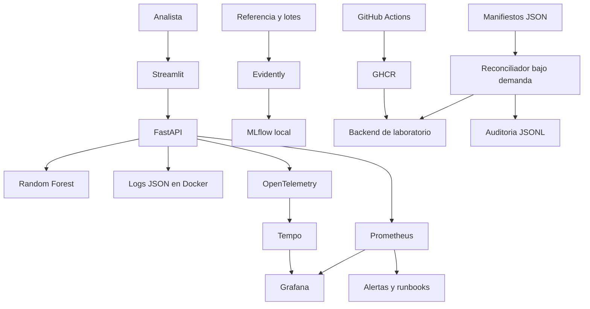
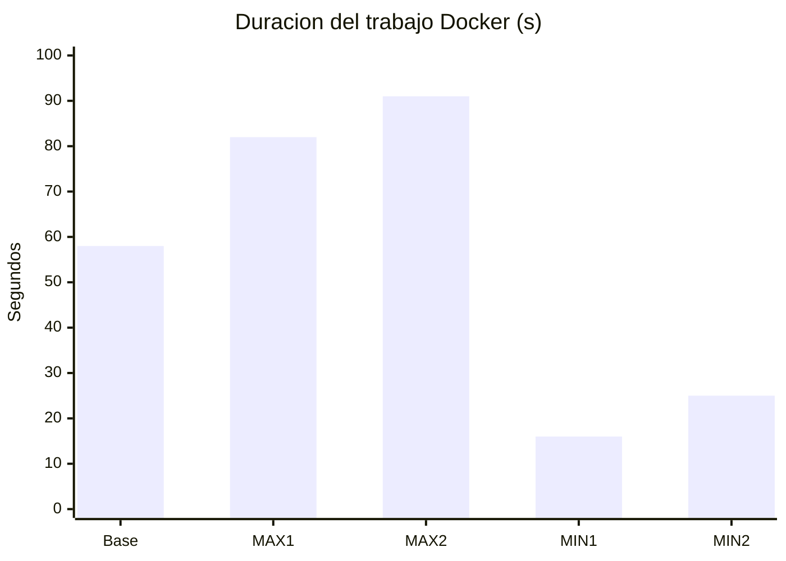

# Sentinel MLOps & GitOps
## Documento técnico de operación

**Fase III | Detección de fraude en seguros de automóviles**

## 1. Resumen ejecutivo

Sentinel integra un modelo Random Forest previamente entrenado con un servicio de inferencia FastAPI, una interfaz Streamlit y mecanismos de observabilidad, control de versiones y automatización. Su finalidad es apoyar la priorización de reclamaciones sospechosas para revisión humana, no determinar fraude de forma definitiva.

La operación combina monitorización técnica, análisis de cambios en los datos, respuesta a incidentes, despliegue versionado y reconciliación declarativa bajo demanda. Se documentaron dos recuperaciones de incidentes simulados, promoción y rollback entre dos imágenes, y tres pruebas de reconciliación. La optimización de Buildx redujo el tiempo promedio observado del trabajo Docker de 58 a 20.5 segundos (64.66%).

## 2. Arquitectura técnica



| Componente | Función | Decisión técnica |
|---|---|---|
| FastAPI / Random Forest | Validación e inferencia | Reutilizar el modelo y API existentes |
| Streamlit | Interfaz de reclamaciones | Separar presentación e inferencia |
| Docker Compose | Orquestación local | Reproducir el entorno sin infraestructura productiva |
| Prometheus / Grafana | Métricas, reglas y visualización | Detectar degradaciones y facilitar diagnóstico |
| Python logging | Eventos JSON | Consultar registros sin incorporar Loki todavía |
| OpenTelemetry / Tempo | Trazas HTTP | Correlacionar solicitudes y tiempos |
| Evidently / MLflow | Drift por lotes y seguimiento experimental | Conservar evaluaciones y reportes |
| GitHub Actions / GHCR | CI/CD e imágenes versionadas | Separar construcción y despliegue |
| Python / JSONL | Reconciliación y auditoría | Automatizar cambios bajo autorización explícita |

Fuente: [arquitectura de observabilidad](arquitectura_observabilidad.md), apartados 3–15; [reconciliación](reconciliacion_gitops.md), apartados 2–10.

## 3. Infraestructura y ambientes

| Configuración | Uso |
|---|---|
| `compose.yaml` | Backend, frontend y observabilidad local |
| `compose.ci.yaml` | Construcción y prueba aislada del backend |
| `compose.release.yaml` | Descarga y ejecución de imagen versionada sin reconstrucción |
| `sentinel-release-lab` | Proyecto Compose aislado para reconciliación y rollback |
| `releases/staging.json` | Versión candidata |
| `releases/production.json` | Versión anterior del laboratorio simulado |

MLflow se inicia como servicio local independiente. El runner de GitHub Actions es temporal; no aloja permanentemente el servicio ni ejecuta el stack completo de observabilidad. En el despliegue aislado se desactiva la exportación de trazas. Los ambientes declarados no equivalen a infraestructura productiva independiente.

## 4. Operación del modelo

El usuario introduce una reclamación en Streamlit. FastAPI valida la entrada de 32 variables, ejecuta el preprocesamiento y Random Forest, calcula la puntuación y aplica el umbral 0.19. La respuesta orienta la revisión del analista.

| Métrica histórica de validación | Resultado |
|---|---:|
| Precision | 29.59% |
| Recall | 31.35% |
| F1-Score | 30.45% |
| FPR | 4.76% |

Fuente: [indicadores SLO](indicadores_slo.md), sección 5.4. El modelo no cumple todos los KPI originales de negocio. Los resultados no son métricas de producción; sin etiquetas reales no se puede medir directamente la calidad de nuevas predicciones. Los falsos positivos y negativos justifican revisión humana y evaluación adicional antes de cualquier uso real.

Los controles de entrada documentados incluyen estructura JSON, variables faltantes, adicionales y nulas. La validación exhaustiva de tipos y rangos permanece pendiente. El pipeline reutiliza el modelo entrenado; no ejecuta reentrenamiento automático.

## 5. Observabilidad del servicio

### Métricas

FastAPI expone `GET /metrics`; Prometheus consulta cada 15 segundos.

| Métrica | Interpretación operativa |
|---|---|
| `sentinel_http_requests_total` | Tráfico y códigos de respuesta |
| `sentinel_http_request_duration_seconds` | Distribución de latencias |
| `sentinel_predictions_total` | Volumen de inferencias |
| `sentinel_fraud_alerts_total` | Reclamaciones sobre el umbral, no fraude confirmado |
| `sentinel_prediction_errors_total` | Errores de inferencia |

El dashboard **Sentinel Observability — Salud y Rendimiento** contiene cuatro paneles: predicciones, p95, solicitudes por segundo y tasa HTTP 5xx. Los dashboards adicionales de saturación, calidad predictiva y gestión de incidentes son propuestas, no resultados implementados.

### Logs y trazas

Los logs JSON pueden incluir timestamp UTC, severidad, servicio, Request ID, método, endpoint, código HTTP y duración. Se consultan mediante `docker compose logs backend`. No se registran intencionalmente reclamaciones completas ni credenciales. Loki queda pendiente.

OpenTelemetry instrumenta solicitudes HTTP y exporta trazas OTLP/gRPC a Tempo; Grafana permite consultarlas. Se verificaron trazas de predicción. Los spans específicos de preprocesamiento e inferencia quedan pendientes.

## 6. SLI, SLO y presupuestos de error

| SLI | Cálculo / medida | SLO propuesto (30 días) |
|---|---|---|
| Disponibilidad | Solicitudes válidas atendidas sin fallo del servidor / solicitudes válidas × 100 | ≥ 99% |
| Latencia | Duración de POST /predict | ≥ 95% en ≤ 500 ms |
| Errores | HTTP 5xx / solicitudes válidas × 100 | < 1% |
| Tráfico | Solicitudes por segundo y volumen de inferencias | Sin objetivo contractual |
| Saturación | CPU, memoria y reinicios | Umbrales pendientes |

Los 4xx se analizan por separado. Para un objetivo de disponibilidad del 99%, el presupuesto es 1% de solicitudes válidas. Su equivalente temporal orientativo en 30 días continuos es 432 minutos (7.2 horas), pero no sustituye la medición basada en solicitudes. Para latencia, el presupuesto es 5% de solicitudes superiores a 500 ms. Los presupuestos se evalúan por separado.

No existe SLA contractual, ni evidencia de cumplimiento mensual, ni cálculo automatizado de consumo del presupuesto. Fuente: [indicadores SLO](indicadores_slo.md), secciones 3–5 y 9.

## 7. Monitorización del modelo y Data Drift

| Parámetro | Valor documentado |
|---|---:|
| Dataset original | 15,420 registros |
| Referencia de entrenamiento | 9,252 registros |
| Tamaño de lote | 1,000 registros |
| Variables del modelo | 32 |
| Variables analizadas | 31 |

Se excluyó PolicyNumber por ser identificador, únicamente del análisis de drift. Se compararon lotes de control y simulados mediante Evidently.

| Escenario | Variables con drift | Proporción |
|---|---|---:|
| Control | 0/31 | 0% |
| Simulado | 2/31 (Age, Make) | 6.45% |

AccidentArea también fue modificada en la simulación, pero no superó el criterio estadístico aplicado. No se concluye degradación predictiva a partir de drift únicamente. El experimento MLflow `Sentinel_Observability_Data_Drift` conserva las ejecuciones `control_refinado` y `simulado_refinado`, métricas y reportes HTML/JSON. No constituye un Model Registry formal.

**Procedimiento de investigación propuesto:** revisar distribuciones y calidad de datos, contrastar con etiquetas reales cuando existan, evaluar desempeño y decidir con aprobación humana si procede reentrenar. No hay alertamiento automático de drift ni reentrenamiento implementado.

Fuente: [arquitectura](arquitectura_observabilidad.md), secciones 10–11.

## 8. Alertas operativas

Reglas en `monitoring/prometheus/rules/sentinel_alerts.yml`:

| Alerta | Condición | Prioridad |
|---|---|---|
| BackendUnavailable | `up == 0` durante 2 minutos | P1 |
| HighErrorRate | HTTP 5xx > 5% durante 5 minutos, con tráfico mínimo | P1 |
| HighLatency | p95 > 500 ms durante 5 minutos, con tráfico mínimo | P2 |

Las ventanas sostenidas y el tráfico mínimo reducen ruido. Los umbrales de alerta no son idénticos a los SLO. P1 requiere diagnóstico inmediato; P2 investigación y mitigación prioritaria; P3 es una categoría preventiva propuesta. Prometheus detecta automáticamente, pero las acciones correctivas son manuales. Alertmanager, notificaciones externas, burn rate y alertas de drift siguen pendientes.

Fuente: [alertas y automatización](alertas_y%20automatizacion.md), secciones 4–10. El nombre del archivo adjunto contiene un espacio; ajustar este enlace si el repositorio utiliza `alertas_y_automatizacion.md`.

## 9. Gestión de incidentes

| Aspecto | INC-001 | INC-002 |
|---|---|---|
| Prioridad | P1 | P2 |
| Escenario | Backend detenido | Retraso artificial de 1.5 s |
| Detección | Prometheus, métrica up | Prometheus y Grafana, p95 |
| Mitigación | Iniciar backend | Retirar retraso y recrear backend |
| Resultado | healthy, alerta Inactive | healthy, alerta Inactive, predicción satisfactoria |

Los runbooks permitieron estructurar diagnóstico, recuperación y verificación. El estado Firing requiere comprobar las capturas originales; los tiempos de detección, recuperación y p95 máximo/posterior no están registrados en los documentos recibidos. No se calcula MTTR ni se afirma recuperación sin interrupciones.

Runbooks: [INC-001](../runbooks/INC-001_backend_unavailable.md), [INC-002](../runbooks/INC-002_high_latency.md). Fuente: [resultados de incidentes](resultados_incidentes.md), secciones 3–8.

## 10. Continuidad operativa y rollback

Se utilizaron dos imágenes GHCR con etiquetas Git diferentes. La secuencia validada fue versión anterior → versión reciente de staging → versión anterior. En cada transición se comprobó `healthy`, los tres Smoke Tests y la referencia desplegada. La recuperación fue manual y controlada; no se probó rollback automático ante fallos ni continuidad sin interrupción.

Criterios de aceptación: imagen disponible, salud correcta, `/health` satisfactorio, `/features` con 32 variables, `/predict` con respuesta JSON válida y coincidencia de referencia. Estas pruebas funcionales no sustituyen una evaluación estadística del modelo.

Fuente: [promoción y rollback](promocion_y_rollback.md), secciones 3–10.

## 11. Reconciliación GitOps

`mlops/reconcile_release.py` lee el manifiesto, valida el repositorio permitido y SHA completo, exige `approved_for_production: false`, consulta el contenedor y compara referencia y salud. Solo modifica infraestructura con `--apply`.

| Prueba | Resultado observado |
|---|---|
| Verificación sin despliegue | OUT_OF_SYNC, check-only |
| Aplicación autorizada | SYNCED, healthy, 3 PASS |
| Segunda aplicación | no-change, mismo ID de contenedor, 3 PASS |

La idempotencia se limita a referencia coincidente y contenedor saludable. No se compara un digest inmutable declarado ni se ejecuta un controlador continuo. El modo de comprobación puede escribir auditoría y, si ya está sincronizado, ejecutar Smoke Tests. Fuente: [reconciliación GitOps](reconciliacion_gitops.md), secciones 4–14 y código compartido.

## 12. Auditoría y trazabilidad

| Objeto | Registro / identificador |
|---|---|
| Código | Commit Git |
| Modelo y metadatos | SHA-256 en `mlops/artifacts/model_manifest.json` |
| Imagen | Tag de commit y digest GHCR |
| Pruebas | Registros de GitHub Actions |
| Despliegue | `sentinel-release-evidence`: release.txt, containers.txt, backend.log |
| Reconciliación | `mlops/artifacts/reconciliation_audit.jsonl` |
| Incidentes | Runbooks y capturas |
| Optimización | Cinco mediciones y evidencias 37–41 |

El workflow conserva artefactos durante 30 días. El manifiesto se genera antes de Pytest: consultar el resultado completo del job antes de considerar una versión validada. El hash permite contrastar identidad con una referencia confiable, no autentica procedencia. El tag puede cambiar y no equivale a un digest inmutable. JSONL registra fecha UTC, ambiente, referencias, IDs, salud, acción, resultado y errores capturados; no es un registro inmutable ni garantiza capturar fallos previos a la apertura del bloque de auditoría.

**Procedimiento recomendado de auditoría:** identificar commit y ejecución, comprobar pruebas, contrastar manifiesto e imagen, revisar diagnóstico y JSONL, asociar evidencia y decisión. Conservar copias autorizadas antes de vencer la retención; excluir secretos y datos personales. No se afirma auditoría independiente ni certificación.

## 13. Optimización basada en resultados

| Trabajo (s) | Base | MAX 1 | MAX 2 | MIN 1 | MIN 2 |
|---|---:|---:|---:|---:|---:|
| Pruebas | 39 | 35 | 43 | 36 | 34 |
| Construcción Docker | 58 | 82 | 91 | 16 | 25 |
| Despliegue | 35 | 29 | 28 | 24 | 28 |
| Suma | 132 | 146 | 162 | 76 | 87 |



La construcción era el trabajo de mayor duración inicial (43.9% de la suma). Buildx con `mode=max` no produjo mejora; no se observaron capas `CACHED` en la segunda ejecución. Se revisó el Dockerfile y se mantuvo su orden de instalación de dependencias antes de copiar código y modelo. Se cambió a `mode=min`, con reutilización de capas observada en MIN 1.

| Indicador | Base | Promedio MIN | Reducción |
|---|---:|---:|---:|
| Pruebas | 39 | 35 | 10.26% |
| Docker | 58 | 20.5 | 64.66% |
| Despliegue | 35 | 26 | 25.71% |
| Suma | 132 | 81.5 | 38.26% |

Reducción = (base − promedio MIN) / base × 100. Se ahorraron en promedio 50.5 segundos acumulados por ejecución observada. Se conserva `cache-from: type=gha,scope=sentinel-backend` y `cache-to: type=gha,mode=min,scope=sentinel-backend`.

La muestra es reducida y no aísla efectos de red, runner, caché previa o publicación. No se atribuye causalidad exclusiva al modo MIN, ni se cuantifica ahorro económico. La suma de trabajos no es necesariamente tiempo transcurrido del workflow. Fuente: [auditoría y optimización](auditoria_optimizacion_pipeline.md), secciones 7–16.

## 14. Seguridad, riesgos y gobernanza

| Riesgo | Control documentado | Pendiente / residual |
|---|---|---|
| Datos inválidos | Validación de esquema | Tipos, rangos, representatividad |
| Drift | Evidently por lotes | Frecuencia automática y etiquetas |
| Alteración del modelo | SHA-256 | Firma y procedencia confiable |
| Fallo de código | CI y Pytest | Cobertura adicional y revisión independiente |
| Versión incorrecta | Tags y manifiestos | Digest fijado y aprobación formal |
| Indisponibilidad | Healthcheck, alertas, runbooks | Recuperación automática |
| Credenciales | .gitignore, token temporal, permisos por job | Gestión centralizada y revisión de accesos |
| Vulnerabilidades | Separación de entornos | Escaneo, SBOM y firma |
| Falsos positivos y sesgo | Revisión humana | Evaluación de equidad y validación independiente |

El permiso general es `contents: read`; construcción tiene `packages: write` y despliegue `packages: read`. Publicación y despliegue solo en push a main. No cargar Joblib de origen desconocido. No publicar `.env`, credenciales o reclamaciones sensibles. No se declara cumplimiento regulatorio.

Responsabilidades propuestas para una futura operación: Data Scientist (calidad), ML Engineer (pipeline), DevOps (infraestructura), Operación (incidentes), Riesgos (controles), Analista (revisión de alertas) y Product Owner (valor). No representan una estructura organizacional ya implantada. Fuente: [gobernanza](gobernanza_y_auditoria.md), secciones 3–13 y 16.

## 15. Manual de operación reproducible

### 15.1 Inicio del stack local

Desde la raíz del repositorio, en CMD de Windows, iniciar Docker Desktop y comprobar `docker info`. Configurar `.env` local con `GRAFANA_ADMIN_PASSWORD` sin publicarlo. Verificar que los puertos estén libres y que no exista otro proyecto Sentinel activo que los utilice.

```cmd
docker compose config --quiet
docker compose up -d --build
docker compose ps
```

| Servicio | Acceso local documentado |
|---|---|
| FastAPI | http://127.0.0.1:8000/docs |
| Streamlit | http://localhost:8501 |
| Prometheus | http://localhost:9090 |
| Grafana | http://localhost:3000 |
| Tempo desde Grafana | http://tempo:3200 |

### 15.2 Verificación y diagnóstico

```cmd
python mlops\smoke_test.py
docker compose logs --tail=50 backend
```

Esperar tres PASS; revisar métricas, dashboard y alertas. Si hay fallo, comprobar salud, logs, versión y trazas. No reiniciar indiscriminadamente. Para drift, con dependencias Python configuradas:

```cmd
python drift\scripts\crear_referencia.py
python drift\scripts\generar_lotes.py
python drift\scripts\analizar_drift.py
python drift\scripts\registrar_mlflow.py
python -m mlflow ui --backend-store-uri ./mlruns --host 127.0.0.1 --port 5000
```

### 15.3 Laboratorio de versiones

Detener primero el stack completo si ocupa el puerto 8000, únicamente desde el proyecto correcto. Verificar acceso a GHCR. Consultar y aplicar staging:

```cmd
python mlops\reconcile_release.py --environment staging
python mlops\reconcile_release.py --environment staging --apply
python mlops\reconcile_release.py --environment staging --apply
```

La última ejecución debe conservar el ID del contenedor si ya coincide y está saludable. Para recuperación manual, seleccionar la imagen anterior declarada en `production.json`, establecer `SENTINEL_IMAGE` y ejecutar Compose con el proyecto aislado; verificar salud, referencia y Smoke Tests. No confundir este procedimiento con rollback automático.

### 15.4 Cierre

Para el stack completo, ejecutar `docker compose down` desde su raíz y verificar `docker compose ps`. Para el laboratorio de versiones, establecer primero la variable `SENTINEL_IMAGE` con la referencia válida de staging o production y ejecutar:

```cmd
docker compose -p sentinel-release-lab -f compose.release.yaml down
docker compose -p sentinel-release-lab -f compose.release.yaml ps
```

No usar `-v` para evitar eliminar volúmenes. Detener MLflow con Ctrl+C en su terminal si se inició. Conservar registros y evidencias antes del cierre. Los comandos son procedimientos documentados, no nuevas ejecuciones realizadas para este informe.

## 16. Matriz de evidencias

Rutas relativas a `docs/`. Las capturas se referencian, no se adjuntan ni se han inspeccionado en esta revisión.

| Evidencia | Archivo / referencia | Resultado respaldado por documentación |
|---|---|---|
| 16 | `evidencias/16_prometheus_alertas_configuradas.png` | Reglas configuradas |
| 17–18 | `17_inc001_alerta_firing.png`, `18_inc001_recuperacion.png` | Recuperación INC-001; Firing pendiente de cotejo |
| 19–22 | `19_inc002_high_latency_firing.png`, `20_inc002_latencia_elevada.png`, `21_inc002_recuperacion.png`, `22_inc002_prediccion_recuperada.png` | Recuperación INC-002; Firing pendiente de cotejo |
| 23–33 | Inventario de Fase III | Validaciones, CI, manifiesto, GHCR y despliegue |
| 34 | [Versión anterior](evidencias/34_rollback_version_anterior_validada.png) | Línea base funcional |
| 35 | [Promoción](evidencias/35_promocion_staging_exitosa.png) | Staging validado |
| 36 | [Rollback](evidencias/36_rollback_version_anterior_exitoso.png) | Versión anterior recuperada |
| 37 | [Base](evidencias/37_auditoria_pipeline_baseline.png) | Docker 58 s |
| 38 | [MAX 1](evidencias/38_docker_cache_primera_ejecucion.png) | Docker 82 s |
| 39 | [MAX 2](evidencias/39_docker_cache_segunda_ejecucion.png) | Docker 91 s |
| 40 | [MIN 1](evidencias/40_docker_cache_mode_min.png) | Docker 16 s |
| 40a | [Capas reutilizadas](evidencias/40a_reutilizacion_capas_docker.png) | CACHED |
| 41 | [MIN 2](evidencias/41_docker_cache_mode_min_confirmacion.png) | Docker 25 s |
| 42 | [Detección](evidencias/42_gitops_deteccion_out_of_sync.png) | OUT_OF_SYNC |
| 43 | [Reconciliación](evidencias/43_gitops_reconciliacion_exitosa.png) | SYNCED y 3 PASS |
| 44 | [Idempotencia](evidencias/44_gitops_idempotencia.png) | no-change |
| 45 | `evidencias/45_pipeline_consolidacion_final.png` | Pendiente de confirmación |

## 17. Limitaciones y evolución propuesta

Prioridad previa a producción: validar calidad predictiva y equidad con etiquetas confiables; establecer aprobación independiente, protección de rama y escaneo de dependencias; fijar digests y firmar artefactos; implantar entorno persistente y reconciliación continua; probar rollback automático con fallos controlados; medir SLO y MTTR en ventanas representativas; centralizar logs, notificaciones y auditoría protegida; automatizar drift y evaluación de candidatos sin sustituir modelos sin aprobación.

La documentación de promoción refleja el momento anterior a la implementación del reconciliador; el estado actualizado es reconciliación bajo demanda, no autónoma. Las métricas de diseño y los controles propuestos se distinguen de los resultados observados. No se ha inspeccionado el repositorio remoto ni cotejado la rúbrica original para este documento.

## 18. Conclusiones

Sentinel demuestra una base operativa reproducible que integra observabilidad, control de versiones, pruebas, recuperación y auditoría. Las dos simulaciones de incidentes y la reconciliación validada muestran capacidad de diagnóstico y recuperación en laboratorio. La optimización documentada aporta una mejora observada de eficiencia, sin confundirla con precisión predictiva ni ahorro económico demostrado. La supervisión humana y los controles pendientes delimitan el alcance responsable del prototipo.

## Referencias documentales

- [Arquitectura de observabilidad](arquitectura_observabilidad.md).
- [Indicadores, SLI, SLO y Error Budgets](indicadores_slo.md).
- [Alertas y automatización](alertas_y%20automatizacion.md).
- [Resultados de incidentes](resultados_incidentes.md).
- [Promoción y rollback](promocion_y_rollback.md).
- [Auditoría y optimización](auditoria_optimizacion_pipeline.md).
- [Gobernanza y auditoría](gobernanza_y_auditoria.md).
- [Reconciliación GitOps](reconciliacion_gitops.md).
