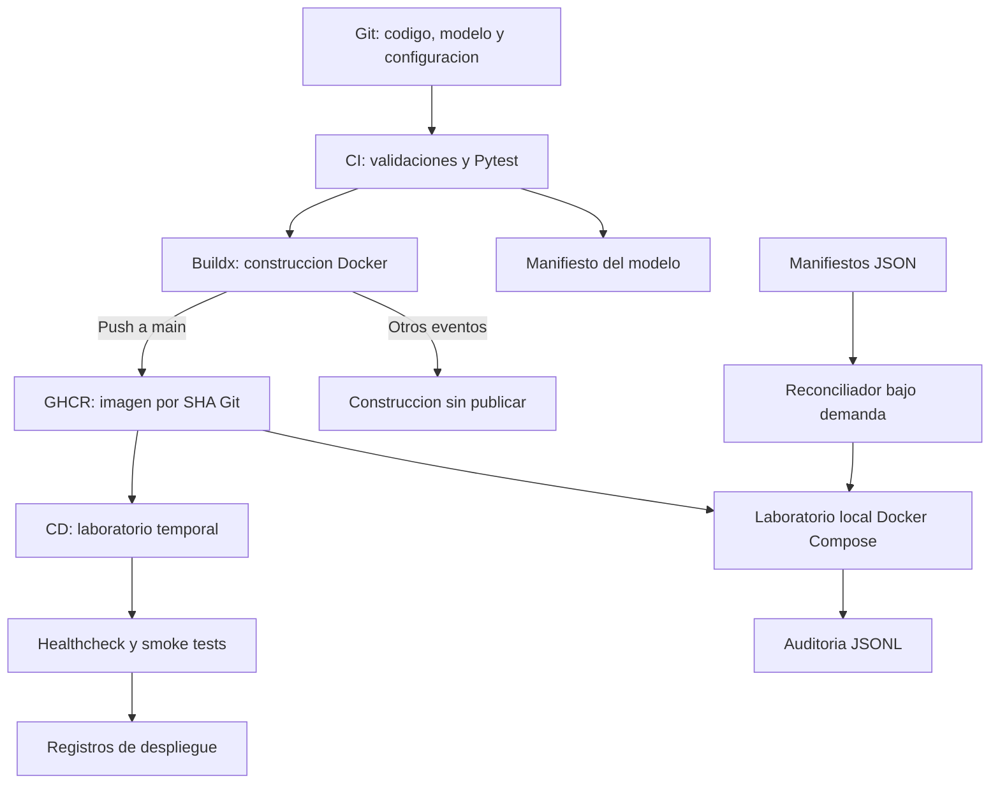
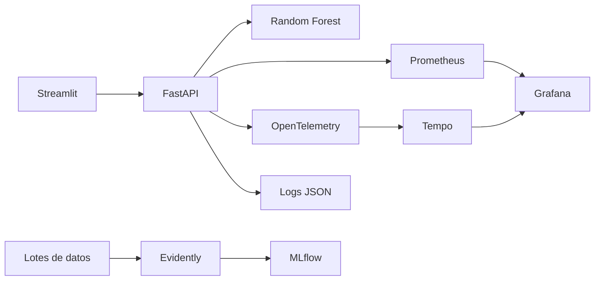

# Sentinel MLOps & GitOps
## Pipeline automatizado de inteligencia artificial

## 1. Resumen ejecutivo

Sentinel integra un modelo Random Forest de detección de fraude en seguros de automóviles con una arquitectura de inferencia, observabilidad y automatización MLOps. La tercera etapa incorpora integración continua, validaciones de código, datos y modelo, versionado de artefactos, publicación de imágenes y despliegue automatizado desde GHCR. Complementa el pipeline con promoción y rollback manuales y reconciliación declarativa bajo demanda.

Las pruebas reportadas durante el desarrollo incluyen 12 pruebas de API satisfactorias, tres smoke tests, recuperación de una versión anterior e idempotencia del reconciliador. La construcción Docker pasó de 58 s a un promedio observado de 20.5 s; la suma de duraciones de los trabajos pasó de 132 s a 81.5 s. Estos resultados son operativos, no mejoras de precisión predictiva.

## 2. Problema y valor de negocio

La revisión de reclamaciones potencialmente fraudulentas requiere priorizar casos sin convertir una predicción estadística en una decisión definitiva. Sentinel propone apoyar al analista mediante inferencias y alertas sujetas a revisión humana. La automatización reduce intervenciones repetitivas y facilita la trazabilidad y recuperación de versiones. No se han medido ahorros económicos, reducción de pérdidas por fraude ni impacto real en clientes.

## 3. Objetivos y evolución

- Primera etapa: desarrollo del modelo y servicio de inferencia.
- Segunda etapa: métricas, trazas, logs, drift y simulaciones de incidentes.
- Tercera etapa: automatización CI/CD, versionado, controles GitOps y optimización basada en mediciones.

El objetivo técnico es verificar cambios antes del despliegue, conservar referencias identificables y comprobar el servicio desplegado. El objetivo estratégico es facilitar una operación reproducible, supervisada y auditable.

## 4. Arquitectura integral



La arquitectura de observabilidad local es independiente del runner de CD:



El despliegue de CI utiliza solo el backend. No demuestra que todo el stack de observabilidad se despliegue automáticamente.

## 5. Stack y decisiones técnicas

| Tecnología | Función y justificación |
|---|---|
| Python 3.11, FastAPI | Entorno de CI alineado con el backend y API de inferencia |
| Random Forest, Joblib | Reutilización del modelo entrenado; evita reentrenamiento innecesario |
| Streamlit | Interfaz de laboratorio |
| Git y GitHub Actions | Historial de cambios y automatización por eventos |
| Pytest | Comprobaciones funcionales repetibles |
| Docker Compose | Orquestación ligera para laboratorio |
| Buildx y caché GHA | Reutilización de capas, evaluada experimentalmente |
| GHCR | Conservación y distribución de imágenes etiquetadas |
| SHA-256 | Identificación del contenido del modelo y metadatos |
| Prometheus, Grafana | Métricas, alertas y visualización |
| OpenTelemetry, Tempo | Instrumentación y consulta de trazas |
| Evidently, MLflow | Análisis de drift por lotes y seguimiento experimental |

No se incorporó Kubernetes ni Argo CD: el alcance educativo no exige un clúster y Compose permite demostrar el mecanismo con menor complejidad. Esta elección limita la reconciliación autónoma y la escalabilidad.

## 6. Ciclo de vida del modelo

El README histórico registra 15,420 reclamaciones, 9,252 registros de referencia de entrenamiento y lotes de drift de 1,000 registros. El modelo recibe 32 variables; el análisis refinado de drift utiliza 31 al excluir PolicyNumber. La exclusión no modifica el modelo. El pipeline actual reutiliza el artefacto entrenado y verifica su carga e inferencia; no automatiza entrenamiento, evaluación comparativa de candidatos ni promoción en un Model Registry.

No se reproducen cifras de Precision, Recall, F1 o ROC-AUC porque no se dispone aquí de los resultados originales verificables. Las pruebas de inferencia no sustituyen una evaluación predictiva sobre datos etiquetados independientes.

## 7. Integración continua

Fuente principal: `.github/workflows/ci.yml`, contenido facilitado por la autora.

| Evento | Tests | Construcción | Publicación GHCR | Despliegue |
|---|---|---|---|---|
| Push a main | Sí | Sí | Sí | Sí |
| Pull request hacia main | Sí | Sí | No | No |
| workflow_dispatch | Sí | Sí | No | No |

Los trabajos se ejecutan en `ubuntu-latest`. `docker-build` depende de `tests`; `deploy-lab` depende de `docker-build` y está condicionado al push a main. Si falla un trabajo previo, no se ejecuta normalmente el dependiente.

El trabajo tests instala `requirements-dev.txt`, configura PYTHONPATH para los módulos internos y establece OTEL_SDK_DISABLED=true. Ejecuta compileall, validate_data, validate_model, version_model, comprueba la existencia del manifiesto, lo publica y ejecuta Pytest. La publicación del manifiesto precede a Pytest: debe consultarse el estado final del trabajo para acreditar éxito.

## 8. Pruebas automatizadas

| Control | Implementación | Resultado reportado |
|---|---|---|
| Sintaxis | compileall backend tests mlops | Ejecuciones CI satisfactorias |
| Datos | validate_data.py | 1 reclamación, 32 variables, esquema y ausencia de nulos |
| Modelo | validate_model.py | Carga e inferencia satisfactorias; probabilidades verificadas cuando disponibles |
| API | tests/test_api.py | 12 pruebas satisfactorias |
| Servicio desplegado | smoke_test.py | /health, /features y /predict: PASS |

La validación de datos se limita a una reclamación de ejemplo; no constituye validación exhaustiva de un dataset. Los smoke tests comprueban disponibilidad, modelo cargado, número de variables y respuesta JSON de predicción; no certifican precisión ni desempeño bajo carga.

## 9. Versionado y trazabilidad

`mlops/version_model.py` genera `mlops/artifacts/model_manifest.json`, asociando el commit de ejecución con los hashes SHA-256 del modelo y metadatos, fecha UTC y número de variables. El artefacto `sentinel-model-manifest` se publica con retención de 30 días y fallo si no existe el archivo.

Buildx publica `ghcr.io/katya925/sentinel-backend:<SHA completo del commit>`. El tag vincula código e imagen, pero puede reasignarse; el digest identifica el contenido de la imagen. Un hash del modelo no es una firma ni prueba de procedencia. El commit del manifiesto identifica la ejecución, no necesariamente el entrenamiento original.

## 10. Despliegue automatizado

El trabajo deploy-lab se autentica en GHCR con GITHUB_TOKEN, normaliza el nombre de imagen, valida compose.release.yaml, descarga el backend y ejecuta `docker compose -f compose.release.yaml up -d --no-build --wait --wait-timeout 120`. Consulta el estado y el ID de imagen, y ejecuta los smoke tests contra localhost:8000.

Los pasos de diagnóstico, publicación y limpieza usan `always()`. Se guardan release.txt (commit y referencia de imagen), containers.txt y backend.log en `sentinel-release-evidence`, con retención de 30 días. El workflow no compara explícitamente el digest del contenedor con un digest esperado. La limpieza se intenta incluso ante fallos; no es garantía ante una interrupción del runner.

## 11. GitOps y reconciliación

Los manifiestos `releases/staging.json` y `releases/production.json` declaran imágenes seleccionadas. Production representa únicamente un ambiente simulado. `mlops/reconcile_release.py` valida el repositorio permitido, SHA completo y aprobación productiva falsa; consulta el estado del contenedor y compara referencia y salud. Sin --apply no modifica contenedores; con --apply aplica el estado deseado cuando difiere. Registra resultados en `mlops/artifacts/reconciliation_audit.jsonl`.

| Prueba local | Resultado reportado |
|---|---|
| Sin despliegue | OUT_OF_SYNC, check-only |
| Aplicación | SYNCED, healthy, tres PASS |
| Repetición | no-change, mismo ID de contenedor, tres PASS |

Se demuestra reconciliación bajo demanda e idempotencia respecto a referencia y salud. No existe un controlador continuo, comparación de digest declarado ni aplicación automática de cambios Git en un entorno persistente. El registro local es modificable.

## 12. Promoción y rollback

Se seleccionaron dos imágenes etiquetadas de GHCR y se descargaron localmente. Se desplegó la anterior, se promovió la reciente y se restauró la anterior. En las tres etapas se reportó backend healthy y tres smoke tests satisfactorios. La referencia desplegada se verificó tras los cambios. Fue una reversión manual planificada, no una recuperación automática provocada por un fallo; no se midió RTO ni se demostró ausencia de interrupciones.

## 13. Optimización experimental

| Trabajo (s) | Base | MAX 1 | MAX 2 | MIN 1 | MIN 2 | Promedio MIN |
|---|---:|---:|---:|---:|---:|---:|
| Pruebas | 39 | 35 | 43 | 36 | 34 | 35 |
| Docker | 58 | 82 | 91 | 16 | 25 | 20.5 |
| Despliegue | 35 | 29 | 28 | 24 | 28 | 26 |
| Suma | 132 | 146 | 162 | 76 | 87 | 81.5 |

```yaml
cache-from: type=gha,scope=sentinel-backend
cache-to: type=gha,mode=min,scope=sentinel-backend
```

Reducción = (base - promedio MIN) / base × 100. Docker: 64.66%; suma: 38.26%. La configuración MAX presentó resultados desfavorables; se revisó el Dockerfile y se cambió a MIN. Se observó CACHED en la primera ejecución MIN. Se conserva MIN por los resultados observados, no por una atribución causal definitiva: hay pocas mediciones, caché previa, diferencias de implementación y variabilidad de runners y red. La suma de trabajos no equivale necesariamente al tiempo transcurrido del workflow.

## 14. Seguridad y gobernanza

El workflow establece contents: read global; docker-build añade packages: write y deploy-lab packages: read. El token temporal evita incluir credenciales personales. Se excluye .env y se restringe la publicación a push en main. Los servicios locales se vinculan a loopback. Solo deben cargarse modelos Joblib confiables. Las alertas de fraude requieren revisión humana; no se declara cumplimiento regulatorio ni evaluación exhaustiva de equidad.

Pendientes: protección de rama y aprobaciones independientes verificadas, escaneo de vulnerabilidades, SBOM, firma de artefactos, fijación de acciones por SHA, digest inmutable y retención de auditoría resistente a modificaciones.

## 15. Evidencias de funcionamiento

Las siguientes referencias corresponden al inventario construido durante el proyecto. Las capturas no se han inspeccionado directamente para este documento; verificar nombres y contenido antes de entregar.

| Evidencia | Resultado documentado |
|---|---|
| 23–25 | Pytest, datos y modelo |
| 26–28 | CI y manifiesto descargable |
| 29–30 | Smoke tests y despliegue automatizado |
| 31–33 | Etiquetado, GHCR y despliegue desde registro |
| 34–36 | Línea base, promoción y rollback |
| 37–41 y 40a | Experimentos de caché y reutilización |
| 42–44 | Detección, reconciliación e idempotencia |
| 45 | Consolidación final: pendiente de confirmación explícita |

Consultar [evidencias](evidencias/), [ejecuciones Actions](https://github.com/Katya925/sentinel-mlops-gitops/actions) y los artefactos de las ejecuciones mientras estén disponibles.

## 16. Reproducción y decisiones operativas

Desde la raíz del repositorio, con Python 3.11 y dependencias instaladas en un entorno aislado, ejecutar `python -m mlops.validate_data`, `python -m mlops.validate_model` y `python -m mlops.version_model`. Para Pytest configurar PYTHONPATH con la raíz y backend, como en CI. En Windows CMD, usar `set "PYTHONPATH=%CD%;%CD%\backend"` y `set "OTEL_SDK_DISABLED=true"`, seguido de `python -m pytest -q tests`.

Para reconciliación local, iniciar Docker Desktop, verificar disponibilidad del puerto 8000 y acceso a GHCR. Ejecutar primero `python mlops\reconcile_release.py --environment staging`; solo si se desea aplicar, añadir `--apply`. No iniciar simultáneamente otro backend en ese puerto. Consultar [reconciliación](reconciliacion_gitops.md) y [rollback](promocion_y_rollback.md) para el procedimiento y limpieza.

La arquitectura completa local requiere una contraseña Grafana en .env, no publicada. Los procedimientos de observabilidad se describen en [arquitectura](arquitectura_observabilidad.md) y [alertas](alertas_y_automatizacion.md).

## 17. Limitaciones y evolución

Prioridades propuestas: (1) ampliar pruebas de datos y calidad predictiva; (2) verificar digests y procedencia; (3) incorporar registro formal de modelos y aprobación independiente; (4) reconciliación continua y rollback automático con pruebas de fallo; (5) automatizar drift y evaluación de desempeño con etiquetas; (6) medir SLO, RTO y costos en un entorno persistente. Ninguna se presenta como implementada.

## 18. Conclusiones

Sentinel demuestra un pipeline de IA que integra validación, versionado, construcción, publicación y despliegue de laboratorio, complementado por observabilidad, recuperación manual y reconciliación bajo demanda. Las decisiones técnicas se apoyan en pruebas y mediciones, incluidas iteraciones desfavorables. El valor estratégico reside en mejorar la capacidad de cambio controlado y trazabilidad, sin confundir una demostración académica con una autorización productiva.

## 19. Referencias y documentación complementaria

- [Auditoría y optimización](auditoria_optimizacion_pipeline.md).
- [Gobernanza y auditoría](gobernanza_y_auditoria.md).
- [Promoción y rollback](promocion_y_rollback.md).
- [Reconciliación GitOps](reconciliacion_gitops.md).
- [GitHub Actions](https://docs.github.com/actions), [Docker Build cache](https://docs.docker.com/build/cache/), [Pytest](https://docs.pytest.org/), [MLflow](https://mlflow.org/docs/latest/).

